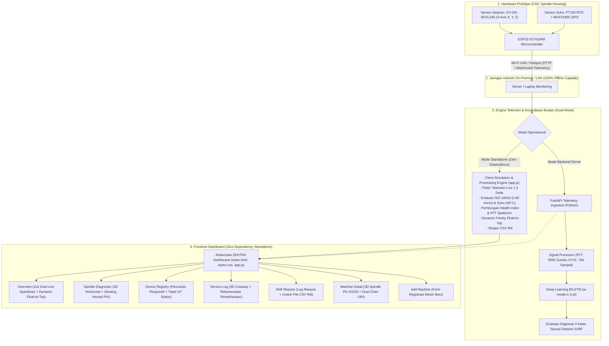

# ZENTRA: Sistem Early Detection dan Diagnosa Kerusakan Komponen Bearing Mesin CNC
> **Dokumen Spesifikasi Teknis, Desain Antarmuka (UI/UX Figma), & Arsitektur Sistem**  
> **Kompetisi**: Kembara UNYVerse 2026 — Sub-Tema Smart Manufacturing (Mitra Industri: PT Yogya Presisi Tehnikatama Industri / PT YPTI)  
> **Tim**: Kata Budi "Pengen Jadi Mapres" — Universitas Negeri Yogyakarta (UNY)  
> **Versi Dokumen**: 2.7 (Finalisasi Shift Reports: Desain Minimalis Aksi Pilih/Batal, Bebas Kedut Hover Card Mesin, Modal Scroll Independen, & Standar Output Cetak A4 Landscape)

---

## 1. Ringkasan Eksekutif & Desain Visual Resmi

Sistem **ZENTRA** (*Zero-downtime Predictive Maintenance for Spindle Bearings*) dikembangkan sebagai solusi *smart condition monitoring* berbasis IoT dan kecerdasan buatan (AI) untuk mendeteksi anomali bearing spindle CNC secara dini, mencegah *catastrophic failure*, serta meminimalkan *unplanned downtime* pada lini produksi presisi tinggi PT YPTI.

### Karakteristik Visual & Desain Antarmuka (Presisi Figma):
1. **Identitas Merek Resmi (Official Brand Identity)**:
   - **Logo 3D ZENTRA (`logo-zentra.png`)**: Logo pita ribbon 3D biru-cyan dengan aksen waveform getaran hijau-mint di tengah dan teks "ZENTRA", berlatar belakang transparan (alpha channel) di pojok kiri atas sidebar.
2. **Tipografi Terstandarisasi (Typography System)**:
   - **Font Family Utama**: **Poppins** (Google Fonts, bobot 300, 400, 500, 600, 700, 800) diterapkan 100% pada seluruh teks, angka, tombol, form input, tabel, SVG sparklines, dan canvas chart.
   - **Ukuran Judul Halaman (Page Titles)**: Menggunakan ukuran **24px (Figma Size 24, SemiBold 600)** untuk semua 5 tampilan utama (*Overview*, *Spindle Diagnostic*, *Device Registry*, *Service Log*, dan *Shift Reports*).
3. **Sidebar Navigasi (Left Sidebar)**:
   - Lebar presisi **`225px`** dengan sudut membulat `border-radius: 24px` dan latar belakang `#0a0d14`.
   - Terdiri dari **5 menu navigasi terstruktur**:
     1. `Overview` (Ikon Grid)
     2. `Spindle Diagnostic` (Ikon Bearing Spindle)
     3. `Device Registry` (Ikon List & Status ID)
     4. `Service Log` (Ikon Dokumen Pemeliharaan)
     5. `Shift Reports` (Ikon Laporan)
4. **Palet Warna Industrial Dark Mode (Figma Gambar 1)**:
   - **Canvas / Body**: `#000000` (Pure Deep Black).
   - **Frames (Sidebar & Main Container)**: `#0a0d14` dengan border halus `rgba(255, 255, 255, 0.08)`.
   - **Cards (Stat Cards & Machine Cards)**: `#121622` (Industrial Dark Navy) dengan border `rgba(255, 255, 255, 0.07)`.
   - **Outer Race Fault Alert (Card EVO-1)**: Border merah menyala `#dc2626` dan glow hazard.
   - **High Urgency Banner**: Radial/linear gelap `rgba(67, 20, 7, 0.45)` dengan aksen oranye `#ea580c` dan tombol *Resolve* oranye solid.
5. **Aset Visual 3D Spindle**:
   - **Foto 3D Spindle Horisontal (`spindle-horizontal.png`)**: Diterapkan pada *Spindle Diagnostic*, *Machine Detail* (pin penunjuk `N1 Rear Bearing` biru dan `N2 Front Bearing` oranye), serta *Add Machine*.
   - **Foto 3D Spindle Potongan Vertikal (`spindle-cutaway.png`)**: Diterapkan pada kartu *Service Log* (*Recommended Maintenance*), memperlihatkan bola bearing bagian depan bawah dengan efek pendar merah menyala (*pulsing glow hotspot*).

---

## 2. Arsitektur Sistem Menyeluruh (End-to-End)



---

## 3. Komponen Hardware Prototipe

- **Mikrokontroler Utama**: ESP32-S3 N16R8 (Xtensa 32-bit Dual-Core 240 MHz, 16MB Quad SPI Flash, 8MB Octal PSRAM, Wi-Fi 802.11 b/g/n, BLE 5.0).
- **Sensor Getaran Triaksial**: GY-291 ADXL345 (Digital Triaxial Accelerometer I2C/SPI, resolusi 13-bit hingga ±16g, noise density rendah).
- **Sensor Suhu Presisi Tinggi**: Sensor PT100 RTD Kabel Tahan Minyak Panas/Coolant + Converter Modul MAX31865 (SPI Platinum RTD Amplifier 15-bit ADC).
- **Enclosure & Mounting**: Magnetic mount housing berspesifikasi industrial grade untuk penempatan langsung pada bearing casing spindle CNC milling.

---

## 4. Klasifikasi AI & Standar Evaluasi Diagnosa (Dataset SUBF)

Sistem mengadopsi 3 kelas kondisi presisi tinggi sesuai standar getaran mesin ISO 10816-3 (Group 1 Rigid: Batas Waspada/Action Limit = **2.80 mm/s**) dan batas termal bearing (**45.0 °C**):

| ID Kelas | Label Kondisi | Indikator Visual | Karakteristik Sinyal | Rekomendasi Tindakan |
| :---: | :--- | :---: | :--- | :--- |
| **0** | **Healthy / Normal** | **Hijau (`#22c55e`)** | $\text{RMS} < 1.80\text{ mm/s}$, suhu $\le 40^\circ\text{C}$, Health Index $> 90\%$. | Operasi normal; pemantauan berkala shift reguler. |
| **1** | **Inner Race Fault (FIR)** | **Kuning / Amber (`#f59e0b`)** | Frekuensi cacat cincin dalam (BPFI 218 Hz), $\text{RMS} = 1.80 - 2.80\text{ mm/s}$, Health Index $70 - 89\%$. | **Peringatan (Medium)**: Jadwalkan inspeksi pelumasan dan clearance bantalan pada shift berikutnya. |
| **2** | **Outer Race Fault (FOR)** | **Merah (`#ef4444`)** | Frekuensi cacat cincin luar (BPFO 142 Hz), $\text{RMS} \ge 2.80\text{ mm/s}$ (melewati batas ISO), suhu $> 45^\circ\text{C}$, Health Index $< 70\%$. | **Tindakan Segera (< 4 jam)**: Hentikan beban potong berlebih, tugaskan teknisi penggantian bantalan N2. |

---

## 5. Rincian Spesifikasi Antarmuka Pengguna (5+2 Tampilan)

### 5.1. Overview (Tampilan Utama — Gambar 1 Figma)
- **Header**:
  - Judul `Overview` (Font Poppins SemiBold, ukuran **24px**).
  - Pill Jam Digital format `HH : MM : SS  WIB` dengan font monospaced Poppins.
  - Tombol aksi `+ Add Machine` (pill hitam ber-border putih).
- **Indikator Urgensi Otomatis (Clean UI)**:
  - Banner peringatan statis atas ditiadakan demi tampilan industrial yang bersih dan luas; status urgensi ditampilkan secara otomatis dan presisi pada kartu mesin (border merah `#dc2626`, badge hazard `Urgent`, dan **Dynamic Priority Float-to-Top** yang mengangkat unit kritis ke posisi teratas).
- **4 Kartu KPI Statistik (Eksklusif di Overview)**:
  1. `Total Machines`: Nilai **4** (atau sesuai jumlah unit terdaftar).
  2. `Normal:`: Nilai **2** (hijau).
  3. `Action required:`: Nilai **2** (oranye/merah).
  4. `Average Spindle Health:`: Nilai persentase rata-rata kesehatan spindle (**75%**).
- **Grid Kartu Mesin CNC 2x2**:
  - Mengimplementasikan **Dynamic Priority Float-to-Top**: unit mesin berstatus *High Urgency* secara otomatis berada di posisi kiri atas.
  - Setiap kartu menampilkan:
    - Nama mesin dan pill durasi `RUN 05:42:18`.
    - **Dual Area Line Chart (SVG Sparkline)**:
      - Kiri: *TREN GETARAN RMS* dilengkapi garis putus-putus merah `ISO 2.80` dan titik nilai terkini.
      - Kanan: *TREN SUHU BANTALAN* dilengkapi garis putus-putus merah `MAX 45°C`.
      - Sumbu waktu bawah: `00`, `06`, `12`, `18`, `24`.
    - **3 Kotak Metrik**: `Vibration RMS` (mm/s), `Spindle Temp` (°C), dan `Health Index` (%).
    - Tombol navigasi cepat: `Detail Diagnostik`.

### 5.2. Spindle Diagnostic
- Judul halaman: `Spindle Diagnostic` (Poppins SemiBold, **24px**).
- Tampilan langsung berfokus pada **Grid Kartu Diagnostik 3D Spindle** (tanpa kartu KPI atau alert banner agar ruang pandang maksimal).
- Grid kartu diagnostik per mesin dengan pratinjau foto 3D horisontal (`spindle-horizontal.png`), animasi pendaran bahaya (*pulsing glow hotspot*), pembacaan parameter telemetri, dan tautan ke halaman detail mesin.

### 5.3. Device Registry
- Judul halaman: `Device Registry` (Poppins SemiBold, **24px**).
- Tampilan fokus langsung ke instrumen IoT:
  - Kolom pencarian dinamis (*search input*) dengan *live filtering* tanpa kehilangan fokus cursor.
  - Tabel konektivitas perangkat IoT (Machine Name, Device ID, IP Address, Status `Connected`, Last Data Received).

### 5.4. Service Log
- Judul halaman: `Service Log` (Poppins SemiBold, **24px**).
- Subjudul: *Recommended Maintenance :*.
- Kartu jadwal pemeliharaan spindle dengan visualisasi foto 3D potongan melintang vertikal (`spindle-cutaway.png`), titik kerusakan bantalan bawah menyala merah, estimasi batas waktu perbaikan (*SLA*), serta tombol penugasan `Tugaskan Teknisi`.

### 5.5. Shift Reports Studio (Interactive Generator & Multi-Machine Selection)
- Judul halaman: `Shift Reports` (Poppins SemiBold, **24px**).
- Mengusung model **Interactive Report Studio / Generator** terpadu di satu layar kerja bersih.
- **1. Baris Atas (Primary Control Bar)**:
  - **Pencarian Mesin**: Input filter cerdas dengan ikon kaca pembesar dan tombol bersihkan (`✕`) yang menyaring kartu unit mesin secara instan berdasarkan nama, ID (`MCH`), atau lokasi workshop.
  - **Tanggal Monitoring**: Input tanggal fleksibel (`<input type="date">`) dengan kalender pemilih bawaan serta dukungan input ketik langsung format tanggal.
  - **Rentang Jam**: Input rentang waktu murni (Waktu Mulai `00:00` s/d Waktu Selesai `23:59`) dilengkapi ikon panduan interaktif (`ⓘ`) dengan hover tooltip ringkas:
    - `• Per Jam : Rentang 1 – 24 Jam`
    - `• Per Menit : Rentang 1 – 30 Menit`
    - `• Per Detik : Rentang 1 – 30 Detik`
  - **Tombol Aksi Dokumen**: Tombol aksen cyan **`Lihat Laporan`** untuk membuka dokumen rekapitulasi resmi di jendela pratinjau modal.
- **2. Sub-Bar Aksi Seleksi Cepat**:
  - Tombol seleksi cepat di sisi kanan:
    - **Pilih Semua**: Saat seluruh mesin terpilih atau tombol diklik, kotak tombol otomatis berubah warna biru solid (`#0284c7`) dengan border cyan `#38bdf8` dan pendaran glow.
    - **Batalkan Semua**: Kotak ber-stroke/border merah tegas (`#ef4444`) dengan latar transparan untuk membatalkan seluruh pilihan secara instan.
- **3. Seleksi Kartu Mesin Interaktif Memanjang (Wide Horizontal Row Cards - Clean Focus)**:
  - Kartu-kartu mesin CNC tersusun rapi memanjang dari kiri ke kanan (wide row):
    - Ikon unit mesin, Nama Mesin (putih tebal), ID Perangkat (`MCH`), Lokasi Bengkel Presisi PT YPTI, dan Sumbu/Tipe Spindle.
    - Status badge diagnosa ditiadakan dari kartu utama agar tampilan visual benar-benar bersih dan lapang.
  - **Efek Hover Terang Langsung Bebas Kedut**: Saat kursor diarahkan ke kartu, kartu langsung menjadi terang secara halus dan kokoh tanpa pergeseran posisi (tanpa jitter/kedut).
  - **Efek Berubah Warna Saat Dipilih**: Saat diklik, kartu berubah warna (*cyan border `#38bdf8` & background gradient*) dengan aksen strip vertikal cyan di sisi kiri.
  - **Kondisi Awal (Default View)**: Saat membuka Shift Reports, sistem tidak memilih mesin secara default (0 mesin terpilih), memberikan kebebasan penuh bagi pengguna untuk memilih mesin yang diinginkan.
- **4. Jendela Pratinjau Dokumen Laporan (Modal Pop-Up Setelah Klik "Lihat Laporan")**:
  - Laporan muncul saat tombol **`Lihat Laporan`** ditekan.
  - **Kop Bersih Terintegrasi**: Bagian kotak metadata dokumen di sisi kanan ditiadakan; informasi ringkasan disatukan menjadi satu baris elegan tepat di bawah nama Mitra Industri dengan format:
    `<Tanggal Monitoring>, <Rentang Waktu>, <Daftar ID Unit Mesin>` (Contoh: `24 Oktober 2026, 00:00 - 23:59 WIB, MCH-001; MCH-002`).
  - **Tabel Rekapitulasi Kondisi Spindle Mesin Terpilih (Tabel Atas Stay)**:
    - Bagian Kop dan tabel ringkasan atas tetap berada di posisi (*stay / non-scrolling*) saat modal dibuka.
    - Kolom: Mesin, Lokasi, Getaran RMS, Suhu Spindle, Health Index, Diagnosa AI, dan Rekomendasi Teknis.
  - **Tabel Log Rincian Telemetri (List Bergulir Independen)**:
    - Menjadi satu-satunya area yang bergulir (*scrollable*) di dalam modal, lengkap dengan judul kolom (*table header*) yang menempel di bagian atas (*sticky header*).
    - Menampilkan log sampling telemetri adaptif (per detik jika rentang $\le 90$ detik, per 1 menit jika rentang $\le 45$ menit, atau per jam jika multi-jam).
    - Menampilkan Waktu, Shift, Unit Mesin, Getaran RMS, Suhu Spindle, Status Diagnosa, dan Catatan Kondisi / Rekomendasi Tindakan Teknis.
    - Baris beranomali diberi penanda peringatan (ISO 10816-3 $> 2.80\text{ mm/s}$ dan Suhu $> 45.0^\circ\text{C}$).
  - Dilengkapi tombol **`Tutup`** dan tombol aksen **`Cetak / Simpan PDF`** untuk mencetak dokumen seketika ke format baku **A4 Landscape** (`@page { size: A4 landscape !important; margin: 8mm 14mm !important; }`), dengan `table-layout: fixed` dan distribusi kolom proporsional 100% sehingga garis batas tepi paling kanan dijamin utuh dan tidak terpotong oleh margin fisik printer (EPSON, dsb).

### 5.6. Machine Detail (Sub-Halaman)
- Navigasi kembali `← Back` dan nama mesin.
- Banner deteksi anomali real-time.
- Visualisasi 3D Spindle dengan pin koordinat:
  - **Pin N1 Rear Bearing** (Biru).
  - **Pin N2 Front Bearing** (Oranye).
- Grafik 24 jam interaktif *Temperature & Vibration Monitoring* dengan garis referensi ISO.
- Speedometer digital (*Gauges*) untuk Suhu, Vibrasi N1, dan Vibrasi N2.

### 5.7. Add Machine (Form Pendaftaran)
- Navigasi kembali `← Back` dan judul *Add Machine*.
- Form pendaftaran unit baru: IP Address, Nama Mesin, Device ID, Axis Type (3-Axis / 5-Axis), dan Tipe Mesin (CNC Milling / Turning).
- Pratinjau 3D spindle live dan tombol simpan *Register Machine*.

---

## 6. Struktur Berkas & Panduan Menjalankan Sistem

```
Web zentra/
├── index.html             # Entry point web utama (Standalone Single-Page Architecture)
├── styles.css             # Stylesheet resmi: Dark theme Figma, Poppins font, 225px sidebar
├── app.js                 # Router, engine simulasi telemetri live, data store, SVG renderer
├── start_zentra.bat       # Launcher 1-klik untuk membuka dashboard langsung di browser default
├── SPECIFICATION.md       # Dokumen spesifikasi teknis resmi ini (v2.2)
├── STRUKTUR_SISTEM.md     # Rincian struktur data, skema objek JavaScript, & integrasi IoT
├── images/
│   ├── logo-zentra.png    # Logo 3D ZENTRA resmi (latar belakang transparan)
│   ├── spindle-horizontal.png  # Render 3D Spindle horisontal untuk diagnostik
│   └── spindle-cutaway.png     # Render 3D Spindle potongan vertikal untuk service log
└── backend/               # Kode opsional untuk integrasi server penuh (FastAPI, PyTorch, ESP32)
    ├── main.py
    └── esp32_firmware/
        └── zentra_esp32_transmitter.ino
```

### Cara Menjalankan untuk Presentasi/Demo Lomba:
1. **Mode Standalone (Direkomendasikan — Bebas Error & Dependensi)**:
   - Cukup klik ganda file [start_zentra.bat](file:///d:/KULIAH/lomba/UNYVERSE%202026/Web%20zentra/start_zentra.bat) atau buka [index.html](file:///d:/KULIAH/lomba/UNYVERSE%202026/Web%20zentra/index.html) di browser apapun (Edge, Chrome, Firefox).
   - Seluruh visualisasi, grafik sparkline, telemetri live, pemindaian fault, dan ekspor CSV langsung berjalan aktif secara lokal tanpa membutuhkan koneksi internet maupun instalasi software tambahan.
