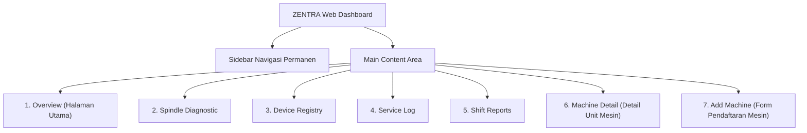

# 📑 Dokumentasi Struktur Sistem ZENTRA

> **Proyek**: ZENTRA — Early Detection & Fault Diagnosis of Spindle Bearing Components on CNC Milling Machines  
> **Kompetisi**: Kembara UNYVerse 2026 (Sub-Tema *Smart Manufacturing* x PT Yogya Presisi Tehnikatama Industri / PT YPTI)  
> **Tim**: Kata Budi "Pengen Jadi Mapres" — Universitas Negeri Yogyakarta (UNY)

---

## 1. Struktur Folder & Berkas Proyek

Arsitektur direktori utama dibuat ringkas dan mandiri (*standalone*) agar dapat dijalankan langsung tanpa kendala dependensi atau server:

```text
Web zentra/
│
├── index.html               # Halaman utama aplikasi (Single Page Application)
├── styles.css               # Seluruh styling tema gelap industri, tata letak grid, & animasi
├── app.js                   # Mesin logika: routing 7 halaman, simulasi sensor real-time, & CSV generator
├── start_zentra.bat         # Launcher 1-klik untuk membuka dashboard di browser default
├── SPECIFICATION.md         # Dokumen spesifikasi fungsional dan teknis sistem
├── STRUKTUR_SISTEM.md       # Dokumen struktur lengkap sistem (arsitektur, data, & UI)
│
├── images/                  # Aset visual 3D CAD Spindle resmi
│   ├── spindle-horizontal.png   # Render 3D spindle horizontal (Overview, Detail, & Add Machine)
│   └── spindle-cutaway.png      # Render 3D spindle potongan vertikal (Service Log)
│
├── backend/                 # [Opsional] Modul integrasi server Python & AI
│   ├── main.py                  # API server FastAPI & WebSocket broadcaster
│   ├── requirements.txt         # Dependensi Python (FastAPI, Uvicorn, NumPy, SciPy)
│   ├── ai/                      # Bobot dan arsitektur model PyTorch BiLSTM (3 kelas)
│   │   ├── model.py             # Definisi kelas VibrationBiLSTM
│   │   └── weights/             # Checkpoint bobot model terlatih (best_lstm_subf_v3)
│   ├── core/                    # Engine pemrosesan sinyal getaran (FFT, RMS, ISO 10816)
│   └── esp32_firmware/          # Source code C++ Arduino untuk mikrokontroler ESP32-S3
│
└── frontend/                # [Opsional] Versi lanjutan berbasis framework Next.js 15
```

---

## 2. Struktur Data (Data Schema)

Seluruh data telemetri dan status operasional mesin dikelola melalui skema objek terstruktur berikut:

### 2.1. Objek Mesin CNC (`Machine`)
Setiap unit mesin CNC direpresentasikan oleh objek JSON dengan struktur sebagai berikut:

```typescript
interface Machine {
  id: string;                    // Kode unik sistem (contoh: "CNC-001", "CNC-004")
  name: string;                  // Nama mesin (contoh: "CNC Milling EVO-1", "Joglo VF-500i")
  modelNumber: string;           // Tipe model mesin
  location: string;              // Posisi fisik di bengkel/lab (contoh: "Bengkel Presisi YPTI - Line 1")
  deviceIp: string;              // IP address node sensor ESP32-S3 (contoh: "192.168.1.101")
  deviceId: string;              // ID perangkat keras IoT (contoh: "MCH-001")
  axisType: "3-Axis" | "5-Axis"; // Konfigurasi sumbu mesin
  machineType: "CNC Milling" | "CNC Turning";
  spindleSpeedRpm: number;       // Kecepatan putar spindle kerja (contoh: 6000 RPM)
  
  // Status Diagnosa AI (3 Kelas Presisi)
  status: "HEALTHY" | "INNER_RACE_FAULT" | "OUTER_RACE_FAULT";
  
  // Metrik Fisik Real-Time
  vibrationRms: number;          // Nilai efektif getaran resultan (mm/s)
  temperature: number;           // Suhu logam spindle dari sensor PT100 (°C)
  vibrationN1: number;           // Getaran spesifik bantalan belakang / Rear Bearing (mm/s)
  vibrationN2: number;           // Getaran spesifik bantalan depan / Front Bearing (mm/s)
  aiConfidence: number;          // Tingkat keyakinan model inferensi (0.00 - 1.00)
  healthIndex: number;           // Indeks kesehatan spindle 0 - 100% (berdasarkan degradasi ISO)
  runHours: number;              // Total jam terbang spindle beroperasi
  lastUpdated: string;           // Status update (contoh: "Live")
  
  // Riwayat untuk Visualisasi
  historyVibRms: number[];       // 7 titik riwayat getaran untuk sparkline & chart
  historyTemp: number[];         // 7 titik riwayat suhu untuk sparkline & chart
  telemetryLogs: TelemetryLog[]; // Log tabel telemetri waktu nyata
  
  // Preskripsi & Rekomendasi
  anomalyMessage: string;        // Pesan peringatan jika terdeteksi anomali
  recommendation: string;        // Rekomendasi tindakan teknis untuk teknisi
  suggestedInspection: string;   // Estimasi jadwal inspeksi perbaikan
}
```

### 2.2. Objek Log Telemetri (`TelemetryLog`)
Data titik waktu berurutan (*time-series*) yang dicatat pada tabel telemetri:

```typescript
interface TelemetryLog {
  timestamp: string;  // Format jam:menit:detik ("14:21:05")
  timeLabel: string;  // Label singkat jam:menit ("14:21")
  temp: number;       // Pembacaan sensor suhu PT100 (°C)
  vibRms: number;     // Nilai getaran RMS gabungan (mm/s)
  vibN1: number;      // Nilai getaran sensor bantalan belakang N1 (mm/s)
  vibN2: number;      // Nilai getaran sensor bantalan depan N2 (mm/s)
}
```

### 2.3. Objek Laporan Shift (`ShiftReport`)
Struktur data untuk pelaporan manajemen dan pembuatan file CSV:

```typescript
interface ShiftReport {
  id: string;              // Nomor kode laporan (contoh: "REP-01")
  title: string;           // Nama shift (contoh: "Shift Pagi (07:00 - 15:00)")
  dateRange: string;       // Tanggal pelaporan ("24 Oct 2026")
  activeMachines: number;  // Jumlah unit mesin yang dipantau
  alertsCount: number;     // Jumlah anomali kritis yang tercatat
}
```

---

## 3. Struktur Tampilan Antarmuka (UI/UX 7 Halaman)

Dashboard menggunakan sistem navigasi dinamis berbasis komponen terpadu:



### Rincian Komponen pada Setiap Halaman:

1. **Sidebar Navigasi (Tetap di Sisi Kiri)**:
   - Brand Logo: `ZENTRA` + *Smart CNC Diagnostic*.
   - 5 Menu Navigasi: *Overview*, *Spindle Diagnostic*, *Device Registry*, *Service Log*, *Shift Reports*.
   - Footer: Indikator status *System: Online* & atribusi kompetisi.

2. **Top Global Bar**:
   - Jam Digital WIB (diperbarui otomatis setiap detik).
   - Tombol Aksi Utama `+ Add Machine`.

3. **Halaman 1: Overview**:
   - *High Urgency Alert Banner* (otomatis muncul jika terdapat mesin dengan status kritis *Outer Race Fault*, lengkap dengan tombol *Resolve*).
   - *4 KPI Stat Cards* (*Total Machines*, *Normal*, *Action Required*, *Average Spindle Health*).
   - *Grid 2x2 Kartu Mesin CNC*:
     - Prioritas *Float-to-Top* (Mesin rusak otomatis berada di urutan teratas: Merah $\rightarrow$ Kuning $\rightarrow$ Hijau).
     - Sparkline ganda: Tren Getaran RMS (Batas ISO $2.80\text{ mm/s}$) & Tren Suhu (Batas Maksimal $45^\circ\text{C}$).

4. **Halaman 2: Spindle Diagnostic**:
   - *4 KPI Stat Cards*.
   - *Grid Kartu Spindle 3D*:
     - Foto render 3D spindle horisontal.
     - Efek animasi pendaran merah menyala (*pulsing glow hotspot*) pada lokasi bantalan yang aus.
     - 3 Pill Metrik (*Vibration RMS*, *Spindle Temp*, *Health Index*).
     - Tombol navigasi langsung ke *Detail Diagnostik*.

5. **Halaman 3: Device Registry**:
   - Kolom pencarian instan (*real-time filter* tanpa reload).
   - Tabel konektivitas IoT (*Machine*, *Device ID*, *Device IP*, *Connection status*, *Last Data Received*).

6. **Halaman 4: Service Log**:
   - Bagian *Recommended Maintenance*.
   - Foto 3D Spindle potongan vertikal (*cutaway*) dengan pendaran merah pada bola bearing bawah.
   - Kartu preskripsi perawatan, estimasi tanggal inspeksi, dan tombol *Tugaskan Teknisi*.

7. **Halaman 5: Shift Reports**:
   - Filter dropdown *Machine* dan *Period*.
   - Daftar riwayat laporan shift.
   - Tombol **View**: Menampilkan modal pratinjau ringkasan shift.
   - Tombol **Download CSV**: Menghasilkan berkas `.csv` resmi yang langsung diunduh ke komputer teknisi.

8. **Halaman 6: Machine Detail** (`machine-detail`):
   - Tombol kembali `← Back` dan nama unit mesin.
   - Banner *Anomaly Detection* (titik merah berdenyut + analisis penyebab).
   - **Baris 1**: Tabel *Output Sensor Live Stream* (kiri) + *3D Spindle Photo Locator* dengan Pin N1 (Rear Bearing, Biru) dan Pin N2 (Front Bearing, Oranye) serta hotspot (kanan).
   - **Baris 2**: Grafik kanvas interaktif pemantauan 24 jam dengan garis putus-putus merah `BATAS ISO (2.80 mm/s)`.
   - **Baris 3**: Kartu status mesin *RUNNING* + 3 *Speedometer Radial Gauges* (*Temperature*, *Vibration N1*, *Vibration N2*).

9. **Halaman 7: Add Machine**:
   - Form pendaftaran node sensor baru (Nama Mesin, IP Address, Device ID, Axis Type, Machine Type).
   - Pratinjau 3D spindle horisontal.
   - Tombol *Register Machine* yang langsung menyuntikkan data baru ke dalam sistem.

---

## 4. Struktur Model Klasifikasi AI & Standar ISO 10816

Sistem menggunakan klasifikasi 3 kelas presisi yang selaras dengan dataset getaran dan model AI BiLSTM:

| ID Kelas | Label Kondisi | Indikator Visual | Karakteristik Sinyal | Batas Standar ISO 10816 | Rekomendasi Tindakan |
| :---: | :--- | :---: | :--- | :--- | :--- |
| **0** | **Healthy / Normal** | **Hijau** (*Optimal*) | Sinyal acak sinusoidal stabil tanpa lonjakan harmonik. | $\text{RMS} < 1.80\text{ mm/s}$ (Zona A/B) | Operasi normal; lanjutkan pemantauan berkala preventif. |
| **1** | **Inner Race Fault (FIR)** | **Kuning / Amber** (*Medium*) | Puncak amplitudo pada frekuensi cacat cincin dalam (BPFI $\approx 218\text{ Hz}$). | $\text{RMS} = 1.80 - 2.80\text{ mm/s}$ (Zona C) | **Waspada**: Jadwalkan pelumasan ulang dan cek celah cincin dalam pada shift berikutnya. |
| **2** | **Outer Race Fault (FOR)** | **Merah** (*Urgent*) | Puncak amplitudo dominan pada frekuensi cacat cincin luar (BPFO $\approx 142\text{ Hz}$). | $\text{RMS} \ge 2.80\text{ mm/s}$ (Zona D - Melewati batas) | **Tindakan Kritis (< 4 Jam)**: Kurangi beban potong, jadwalkan penggantian bantalan segera. |

---

## 5. Struktur Arsitektur IoT & Komunikasi Data

```text
[Sensor Getaran ADXL345]  ──(I2C)──┐
                                   ├──> [ESP32-S3 Microcontroller]
[Sensor Suhu PT100 MAX31865] ──(SPI)──┘              │
                                                     │ (Wi-Fi LAN / Hotspot JSON)
                                                     ▼
                                      [Web Dashboard ZENTRA]
                                      (Standalone Client Engine)
                                      ├── Evaluasi Standar ISO 10816
                                      ├── Dynamic Sorting Float-to-Top
                                      └── Visualisasi 3D & Sparklines
```

1. **Edge Acquisition**: ESP32-S3 mengumpulkan burst getaran 3-sumbu ($X, Y, Z$) dan membaca temperatur permukaan rumah spindle.
2. **Konektivitas Fleksibel**:
   - **Mode Lapangan**: Mengirim telemetri HTTP/WebSocket JSON ke server.
   - **Mode Demo Standalone**: Memiliki *Live Simulation Engine* tertanam di browser sehingga dapat dipresentasikan secara mandiri tanpa tergantung jaringan eksternal.
